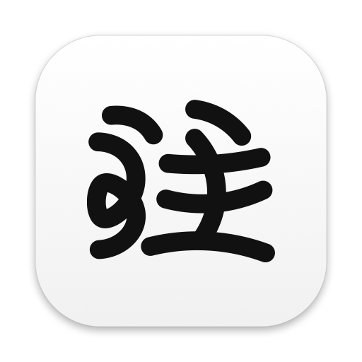
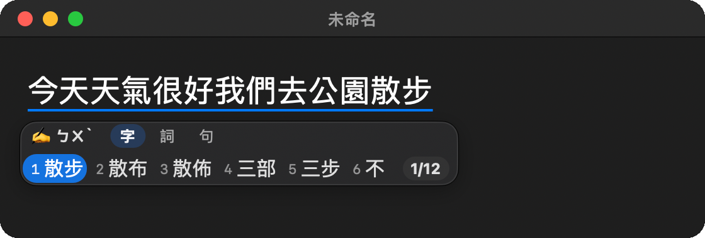
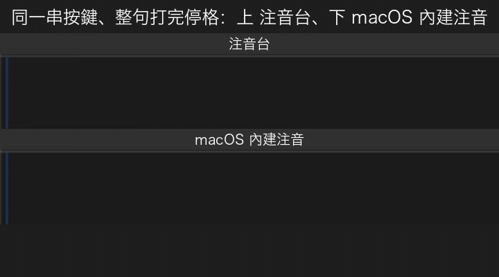
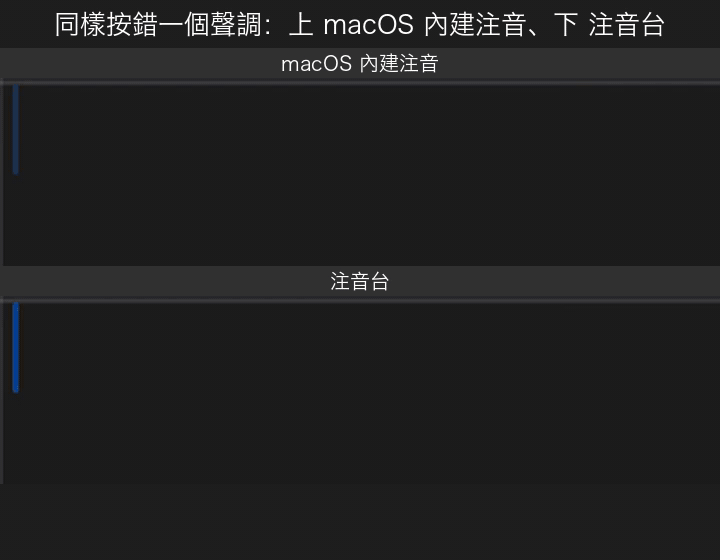
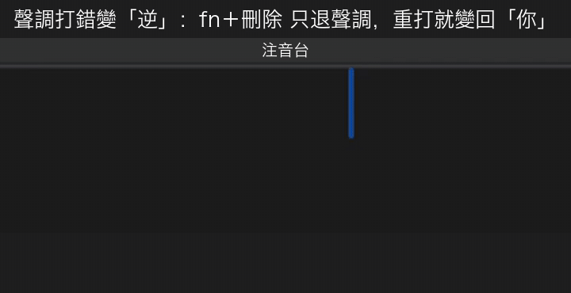
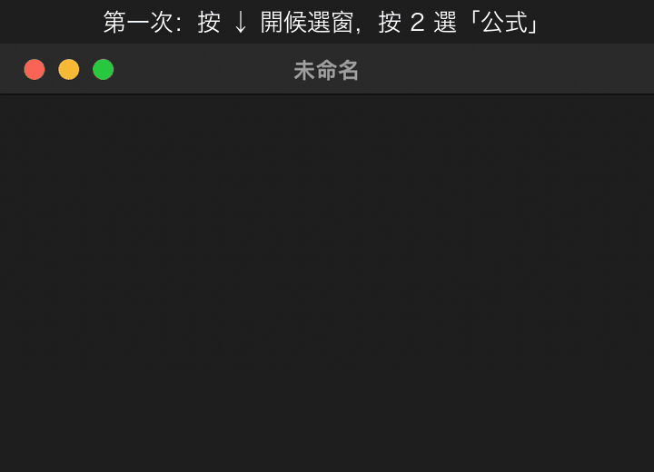
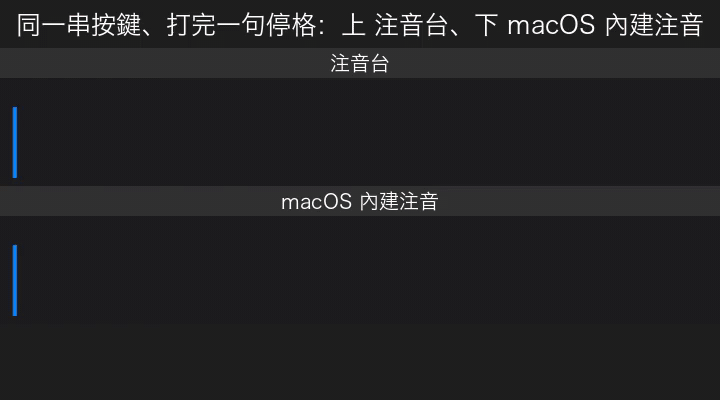
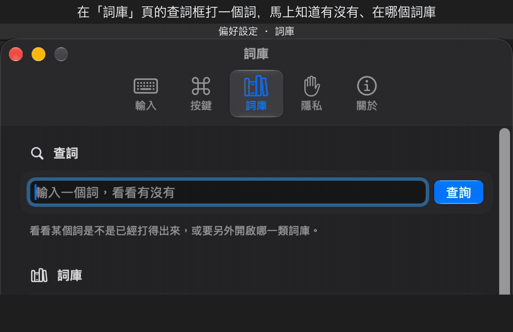
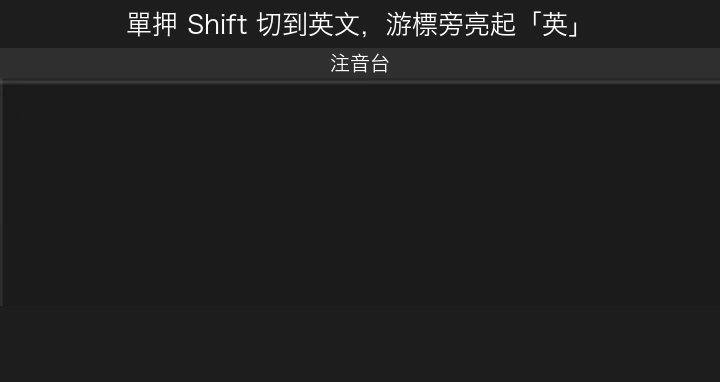
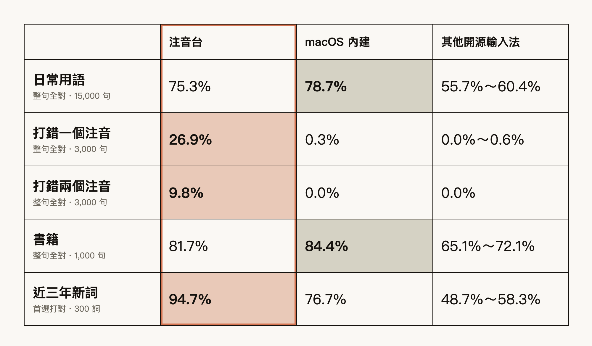

  
  <h1>注音台</h1>
  <h3>比語音更安靜，比注音更懂你。</h3>
  
語音輸入很方便，但在辦公室、咖啡廳，沒有人想對著電腦把訊息唸出來。注音台是 Mac 上的注音輸入法，它用 AI 語言模型讀整句話來選字，按錯注音也會幫你修正——讓鍵盤打字更準一點，少選字、少回頭，讓心流不被打斷。

  

    
  

  macOS 14 以上 ・ Apple Silicon ・ 免費

 

  

## 開始使用

> 免費下載使用。需要 macOS 14 以上、Apple Silicon（M1 以後）的 Mac。

1. **下載**：到 [Releases 頁](https://github.com/kota449/zhuyintai/releases/latest) 下載 `ZhuyinTai-<版本>.pkg`。
2. **安裝**：雙擊 .pkg，照畫面一路按「繼續」。
3. **加入輸入法**：打開「系統設定 → 鍵盤 → 輸入方式」，按「＋」，找到「注音台」加入。
4. **切換**：從選單列的輸入法圖示切到「注音台」，就可以開始打字。

### 基本操作

| 想做什麼 | 怎麼按 |
| --- | --- |
| 整句輸入 | 連續打注音，打完按 Enter 送出 |
| 換字 | 按 ↓ 打開候選窗，用選字鍵挑字，候選多時可以翻頁 |
| 切換中／英 | 單按一下 Shift，游標旁出現「英」就是英文模式 |
| 加自己的詞 | 偏好設定 →「詞庫」頁最下面的「我的自訂詞」 |
| 打開設定 | 選單列輸入法圖示 →「偏好設定…」 |

詳細步驟：[安裝說明](docs/INSTALL.md) ・ [解除安裝](docs/UNINSTALL.md) ・ [已知問題](docs/KNOWN_ISSUES.md)

## 特色

### 能理解整句話的輸入法

透過自研語言模型引擎，輸入法會看完整句前後文才決定每一個字。所以你只管打字，模型就會自己幫你把字選對！

  

### 按錯注音，它幫你救回來

按到隔壁的鍵、聲調按錯，注音台會猜你本來想打的是什麼。猜對了，整句照樣組對；猜不到，候選窗一樣讓你自己挑。

  

### 拼錯的注音，看得見

游標下方即時顯示你打的注音。錯在哪，一眼就看到。想改單個注音嗎？Fn+ 刪除 快捷鍵也可以讓你單改！

  

### 越用，越像你

改選過的字，記憶系統會在下次在同樣的地方自動排前面。記憶只留在你的 Mac，想關、想清，一鍵就好。

  

### 詞庫，說台灣的話

內建詞庫以台灣用語為主並持續更新。並另外有多個領域詞庫包：網路用語（預設開啟）、理工與資訊、生命與地球、人文社會藝術等等。

  

### 找詞，一秒有答案

在詞庫頁打一個詞：已經內建？在哪個詞庫包？還是一鍵加進自訂詞？馬上知道。

  

### 中英切換，一眼就知道

單押 Shift 切到英文，游標旁亮起小小的「英」。不會再打完一整行，才發現模式不對。

  

## 實測比較

同一批題目，第一選擇完全正確才算對；句子要整句全對，新詞看單詞。

  

## 已知問題

這是 Beta，還有一些我們知道、正在改的地方：

- **選字還不夠準**：有些詞的候選順序不理想，有些詞還找不到。遇到的話，歡迎附上你打的注音與你想要的字詞回報。
- **「英」提示在部分 App 有時不會出現**：這時其實已經在英文模式，單押一下 Shift 就會切回中文。

完整清單：[已知問題](docs/KNOWN_ISSUES.md)。

## 常見問題

**要錢嗎？** 不用，注音台免費使用。

**我打的字會被上傳嗎？** 不會。注音台全程在你的 Mac 上運算，打字不必連網。唯一的連線是檢查有沒有新版，可以在「偏好設定 → 關於」關掉。

**它會記錄我打字嗎？** 預設會記在你的 Mac 上，只保留約一週、不會送出，可以在「偏好設定 → 隱私」關掉。[完整隱私說明](docs/PRIVACY.md)

**Windows 或 Intel 的 Mac 可以用嗎？** 目前只支援 Apple Silicon（M1 以後）、macOS 14 以上的 Mac。

**更新之後找不到輸入法？** 到「系統設定 → 鍵盤 → 輸入方式」把「注音台」移除，再重新加入一次。

**字排錯、詞找不到，怎麼回報？** 告訴我們你打的注音，和你想要的字詞，我們會整理進下一版。[怎麼回報](docs/FEEDBACK.md)

## 接下來

- 原始碼已經在這個 repo，建置方式見 [BUILDING.md](docs/BUILDING.md)；歡迎一起補詞、改進。
- 全面提升介面與操作體驗：候選窗、偏好設定與日常操作的細節，貼近 macOS 最新的設計風格。
- 持續補詞，並調整同音字與網路用語的候選順序。
- 打錯注音的修正，繼續改進。
- 讓游標旁的「英」提示在更多 App 裡都看得到。
- 視需求評估 Windows 與 iOS 版本。

## 授權與致謝

注音台目前是 Beta 測試版，免費使用。有些功能還不夠完善，歡迎踴躍[回報](docs/FEEDBACK.md)。

原始碼已經放在這個 repo（建置見 [BUILDING.md](docs/BUILDING.md)）；詞庫以 MPL-2.0 開放，歡迎一起補詞。

注音台站在這些開源專案的肩膀上：

- [小麥注音](https://mcbopomofo.openvanilla.org/) 的詞庫（MIT）
- libtabe 詞庫（BSD）
- 威注音的候選窗（木蘭寬鬆許可證 2.0）與 Megrez 組字引擎（LGPL-3.0）
- KenLM 語言模型程式庫（LGPL）
- 國家教育研究院「[樂詞網](https://terms.naer.edu.tw/)」的學術名詞

完整授權聲明：偏好設定 → 關於 →「開放原始碼授權…」。

## 原始碼與建置

這個 repo 放注音台 Mac 版的原始碼。程式碼用 Apache-2.0 授權，詞庫投稿檔用 MPL-2.0。

- [BUILDING.md](docs/BUILDING.md)：從原始碼建置、裝到自己的電腦
- [CONTRIBUTING.md](CONTRIBUTING.md)：怎麼參與（補詞、回報、改程式）與 DCO 簽署
- [LICENSE](LICENSE)：Apache-2.0 全文；第三方元件的授權見 [NOTICE](NOTICE)

從原始碼建置的版本，選字結果可能與 [Releases](https://github.com/kota449/zhuyintai/releases/latest) 的安裝包不同；要日常使用請下載 Releases 的安裝包。

© 注音台
