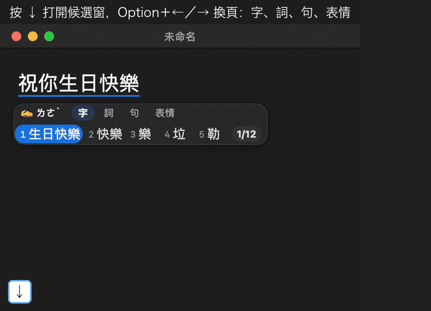

  
  <h1>注音台</h1>
  <h3>比語音更安靜，比注音更懂你。</h3>
  
語音輸入很方便，但在辦公室、咖啡廳，沒有人想對著電腦把訊息唸出來。注音台是 Mac 上的注音輸入法，它用 AI 語言模型讀整句話來選字，按錯注音也能幫你修正——讓鍵盤打字更準一點，少選字、少回頭，讓心流不被打斷。

  

    
  

  macOS 14 以上 ・ Apple Silicon ・ 免費 ・ <a href="https://github.com/kota449/zhuyintai/releases/latest">beta.2 更新了什麼 →</a>

 

  <picture>
    <source media="(prefers-color-scheme: light)" srcset="docs/images/02-candidates-light.png">
    
  </picture>

## 開始使用

> 免費下載使用。需要 macOS 14 以上、Apple Silicon（M1 以後）的 Mac。

1. **下載**：到 [Releases 頁](https://github.com/kota449/zhuyintai/releases/latest) 下載 `ZhuyinTai-<版本>.pkg`。
2. **安裝**：雙擊 .pkg，照畫面一路按「繼續」。
3. **加入輸入法**：打開「系統設定 → 鍵盤 → 輸入方式」，按「＋」，找到「注音台」加入。
4. **切換**：從選單列的輸入法圖示切到「注音台」，就可以開始打字。

### 基本操作

| 想做什麼 | 怎麼按 |
| --- | --- |
| 整句輸入 | 連續打注音，打完按 Enter 送出 |
| 換字 | 按 ↓ 打開候選窗，用選字鍵挑字，候選多時可以翻頁 |
| 切換中／英 | 單按一下 Shift，游標旁出現「英」就是英文模式 |
| 全形／半形標點 | 按 ⌥⇧H 切換（預設全形），輸入法選單也有「半形標點」可勾選 |
| 加自己的詞 | 偏好設定 →「詞庫」頁最下面的「我的自訂詞」 |
| 打開設定 | 選單列輸入法圖示 →「偏好設定…」 |

詳細步驟：[安裝說明](docs/INSTALL.md) ・ [解除安裝](docs/UNINSTALL.md) ・ [已知問題](docs/KNOWN_ISSUES.md)

## 特色

### 實測比較：注音台、macOS 內建注音、靈犀注音與其他開源輸入法

同一批題目、同一串按鍵，讓每個輸入法各打一遍，看第一選擇就完全打對的比例（句子要整句全對、新詞要整個詞對才算）。

| 題目 | 注音台 | macOS 內建 | 靈犀注音 | 其他開源 |
| --- | ---: | ---: | ---: | ---: |
| 整句綜合（8,000 句） | 87.4% | 83.8% | 89.5% | 59.3%～67.4% |
| 打錯一個注音（999 句） | 34.8% | 0.3% | 0.5% | 0.0%～0.3% |
| 近三年新詞（300 詞） | 90.7% | 76.7% | 76.3% | 48.3%～58.3% |

・整句綜合：書籍 2,000 句、PTT 日常口語 2,000 句、約 2023–24 年新聞 2,000 句，加上 2026 年 10 月台灣新聞 2,000 句（12 家媒體、發表於 10/5–10/16）。書籍的句子沒有用在注音台的訓練資料裡；10 月新聞發表於注音台語言模型完成之後。 
・打錯注音：在正確按鍵上隨機換成隔壁鍵或錯的聲調。 
・近三年新詞：題目取自注音台收錄的詞。 
・注音台為 0.1.0-beta.2；靈犀注音含神經重排；其他開源：小麥注音、威注音、新酷音、RIME、融鍵、隨便打。各家版本與量測方式見<a href="docs/BENCHMARK.md">量測方法</a>。

### 打完就對，不用選字

<table>
<tr>
<td width="44%" valign="top" align="left">

**看完整句前後文，才決定每一個字。**

- 用自研語言模型引擎選字
- 打字途中，前面的字會隨後文進來自動翻對
- 整句打完，不用一個字一個字選

畫面為重現示意，組字結果由注音台引擎（與 macOS 內建注音）以同一串按鍵實際算出

</td>
<td width="56%" valign="top" align="left"></td>
</tr>
</table>

### 按錯注音，它幫你救回來

<table>
<tr>
<td width="44%" valign="top" align="left">

**按到隔壁的鍵、聲調按錯，它會猜你本來想打的字。**

- 猜對了照樣組對，猜不到就在候選窗挑
- 常用詞（例：那裡、照樣）打對了不會被改掉
- 空白或 Enter 收尾一律當一聲（同小麥、威注音）
- 預設關閉：「偏好設定 → 輸入」開啟「打錯字自動修正（Beta）」

畫面為重現示意，組字結果由注音台引擎（與 macOS 內建注音）以同一串按鍵實際算出，注音台一側已開啟自動修正

</td>
<td width="56%" valign="top" align="left"></td>
</tr>
</table>

### 字、詞、句，分頁挑

<table>
<tr>
<td width="44%" valign="top" align="left">

**按 ↓ 打開候選窗，分成「字」「詞」「句」三頁。**

- 換一個字、一個詞或整句，用 Option＋←／→ 切過去挑
- 打到有表情符號的詞，多一頁「表情」
- 小視窗出現和消失會淡入淡出，跟著系統「減少動態效果」調整

畫面為重現示意：文字編輯區是示意畫面，候選窗是注音台的實際畫面，內容由注音台引擎以同一串按鍵實際算出

</td>
<td width="56%" valign="top" align="left"></td>
</tr>
</table>

### 拼錯的注音，看得見

<table>
<tr>
<td width="44%" valign="top" align="left">

**游標下方即時顯示你打的注音，錯在哪一眼就看到。**

- 只想改一個注音：按 Fn＋刪除（fn＋⌫）單獨退掉它
- 例：聲調打錯，只退聲調重打就好
- 要單獨打出注音：組字時按 ⌃＋⌘＋Enter，直接送出組字區的注音（含聲調）

</td>
<td width="56%" valign="top" align="left"></td>
</tr>
</table>

### 越用，越像你

<table>
<tr>
<td width="44%" valign="top" align="left">

**改選過的字，下次在同樣的地方自動排前面。**

- 記憶只留在你的 Mac
- 想關、想清，一鍵就好

畫面為重現示意：文字編輯區是示意畫面，候選窗是注音台的實際畫面，內容由注音台引擎以同一串按鍵實際算出

</td>
<td width="56%" valign="top" align="left"></td>
</tr>
</table>

### 詞庫，說台灣的話

<table>
<tr>
<td width="44%" valign="top" align="left">

**beta.2 詞庫大改版**

- 專業詞庫重整成 6 大類 30 小類，**裝好就全開**，約 2,300 個專業詞直接打得出來
- 再補進約 700 個台灣常用詞，像「健檢」「臥蠶」「即視感」
- 用不到的小類，到「偏好設定 → 詞庫」關掉

6 大類：自然科學、資訊與工程、生命與醫療、交通與軍事、人文社會、藝術與生活。畫面為重現示意，組字結果由注音台引擎（與 macOS 內建注音）以同一串按鍵實際算出

</td>
<td width="56%" valign="top" align="left"></td>
</tr>
</table>

### 找詞，一秒有答案

<table>
<tr>
<td width="44%" valign="top" align="left">

**在詞庫頁打一個詞，馬上知道：**

- 已經內建了嗎？
- 在哪個詞庫包？
- 都沒有？一鍵加進自訂詞

</td>
<td width="56%" valign="top" align="left"></td>
</tr>
</table>

### 中英切換，一眼就知道

<table>
<tr>
<td width="44%" valign="top" align="left">

**單押 Shift 切到英文，游標旁亮起小小的「英」。**

- 不會打完一整行，才發現模式不對
- 再單押一次 Shift 切回中文

</td>
<td width="56%" valign="top" align="left"></td>
</tr>
</table>

## 已知問題

這是 Beta 版，部分細節仍在持續調整，詳見[已知問題](docs/KNOWN_ISSUES.md)。

## 常見問題

**要錢嗎？** 不用，注音台免費使用。

**我打的字會被上傳嗎？** 不會。注音台全程在你的 Mac 上運算，打字不必連網。唯一的連線是檢查有沒有新版，可以在「偏好設定 → 關於」關掉。

**它會記錄我打字嗎？** 預設會記在你的 Mac 上，只保留約一週、不會送出，可以在「偏好設定 → 隱私」關掉。[完整隱私說明](docs/PRIVACY.md)

**Windows 或 Intel 的 Mac 可以用嗎？** 目前只支援 Apple Silicon（M1 以後）、macOS 14 以上的 Mac。

**更新之後找不到輸入法？** 到「系統設定 → 鍵盤 → 輸入方式」把「注音台」移除，再重新加入一次。

**字排錯、詞找不到，怎麼回報？** 告訴我們你打的注音，和你想要的字詞，我們會整理進下一版。遇到當機或異常，可以在「偏好設定 → 關於 → 產生診斷包…」產生一份不含打字內容的診斷資訊一起附上。[怎麼回報](docs/FEEDBACK.md)

## 接下來

- 介面與操作體驗持續優化
- 詞庫與選字持續擴充
- 更多平台支援評估中
- ⋯⋯

## 授權與致謝

原始碼 Apache-2.0（[LICENSE](LICENSE)）・詞庫 MPL-2.0（[LICENSES/MPL-2.0.txt](LICENSES/MPL-2.0.txt)）・第三方元件見 [NOTICE](NOTICE)。

安裝與使用注音台請見[使用條款](docs/EULA.md)。

致謝：[小麥注音](https://mcbopomofo.openvanilla.org/)（MIT）、libtabe（BSD）、威注音候選窗（木蘭寬鬆許可證 2.0）、Megrez（LGPL-3.0）、KenLM（LGPL）、國家教育研究院[樂詞網](https://terms.naer.edu.tw/)。

## 原始碼與建置

這個 repo 放注音台 Mac 版的原始碼。程式碼用 Apache-2.0 授權，詞庫投稿檔用 MPL-2.0。

- [BUILDING.md](docs/BUILDING.md)：從原始碼建置、裝到自己的電腦
- [CONTRIBUTING.md](CONTRIBUTING.md)：怎麼參與（補詞、回報、改程式）與 DCO 簽署
- [LICENSE](LICENSE)：Apache-2.0 全文；第三方元件的授權見 [NOTICE](NOTICE)

從原始碼建置的版本，選字結果可能與 [Releases](https://github.com/kota449/zhuyintai/releases/latest) 的安裝包不同；要日常使用請下載 Releases 的安裝包。

© 注音台
